# Weather App – AWS EKS Deployment with Terraform and GitHub Actions

A modern, responsive weather forecasting web application deployed on **Amazon Web Services (AWS) using Amazon Elastic Kubernetes Service (EKS)**.

The application integrates the OpenWeatherMap API to retrieve real-time weather information, hourly forecasts and 5-day weather predictions.

This project demonstrates end-to-end cloud infrastructure provisioning, containerisation, Kubernetes orchestration and automated CI/CD deployment using Terraform, Amazon ECR and GitHub Actions.

## 1. Project Overview

The Weather App allows users to search for weather conditions in different cities or retrieve weather information using their device's geographical location.

Beyond frontend development, this project demonstrates practical DevOps and cloud engineering skills through the deployment of a containerised application to AWS.

The infrastructure is provisioned using Terraform, while GitHub Actions automates the application build, container image publishing and Kubernetes deployment.

## 2. Application Features

### Current Weather Information
- Current temperature.
- Feels-like temperature.
- Weather descriptions and conditions.
- Humidity.
- Wind speed.
- Cloud coverage.
- Atmospheric pressure.
- Sunrise and sunset times.

### Weather Forecasts
- Hourly weather forecasts.
- 5-day weather forecasts.
- Temperature and weather condition information.

### Interactive Features
- Search weather information by city.
- Browser geolocation support.
- Celsius and Fahrenheit conversion.
- Light and dark display themes.
- Dynamic date and time.
- Responsive interface for different screen sizes.

## 3. Technology Stack

| Technology | Purpose |
|---|---|
| HTML5 | Application structure |
| CSS3 | Styling and responsive design |
| JavaScript | Application logic and interactivity |
| OpenWeatherMap API | Weather data and forecasts |
| Fetch API | External API communication |
| Docker | Application containerisation |
| Nginx | Web server inside the container |
| Amazon ECR | Container image storage |
| Amazon EKS | Kubernetes orchestration |
| Kubernetes | Application deployment and service management |
| AWS Application Load Balancer | External application access |
| Terraform | Infrastructure as Code |
| GitHub Actions | CI/CD automation |
| AWS IAM OIDC | Secure GitHub Actions authentication |

## 4. AWS Cloud Architecture

The application is deployed using the following architecture:

```text
Developer
    |
    v
GitHub Repository
    |
    v
GitHub Actions
    |
    |-- Authenticate with AWS using OIDC
    |
    |-- Build Docker Image
    |
    v
Amazon ECR
    |
    |-- Store Container Image
    |
    v
Amazon EKS
    |
    |-- Kubernetes Deployment
    |-- Kubernetes Service
    |
    v
AWS Application Load Balancer
    |
    v
Weather App
    |
    v
OpenWeatherMap API
```

### AWS Services

| AWS Service | Responsibility |
|---|---|
| Amazon VPC | Isolated cloud networking |
| Public Subnets | Host the internet-facing load balancer |
| Internet Gateway | Internet connectivity for public subnets |
| Amazon EKS | Managed Kubernetes control plane |
| Amazon EC2 | Kubernetes worker nodes |
| Amazon ECR | Docker image repository |
| AWS IAM | Identity and access management |
| IAM OIDC Provider | GitHub Actions workload authentication |
| Application Load Balancer | Routes external traffic to the application |

## 5. Infrastructure as Code – Terraform

Terraform is used to provision and manage the AWS infrastructure.

The infrastructure configuration includes:

- VPC and subnet configuration.
- Internet Gateway and routing.
- EKS cluster.
- EKS managed node group.
- IAM roles and policies.
- GitHub Actions OIDC integration.
- Amazon ECR repository.
- Networking and security configuration.

Infrastructure changes are managed through Terraform plans and applies.

This approach makes the infrastructure configuration version-controlled and reproducible.

## 6. CI/CD Pipeline – GitHub Actions

GitHub Actions automates the application deployment process.

### Deployment Workflow

1. **Source Control:** Developer pushes application changes to the GitHub repository.
2. **Workflow Trigger:** GitHub Actions detects relevant changes on the `main` branch.
3. **AWS Authentication:** GitHub Actions authenticates with AWS using OpenID Connect (OIDC).
4. **Docker Build:** The hosted GitHub Actions runner builds the application container image.
5. **Image Publishing:** The container image is pushed to Amazon ECR.
6. **Kubernetes Authentication:** The workflow configures access to the Amazon EKS cluster.
7. **Load Balancer Controller:** The workflow installs or upgrades the AWS Load Balancer Controller using Helm.
8. **Application Deployment:** Kubernetes manifests are applied to the EKS cluster.
9. **Deployment Verification:** The workflow checks application rollout, load balancer provisioning and HTTP availability.
10. **Deployment Summary:** GitHub Actions publishes the application URL and deployment details.

### CI/CD Security

The pipeline uses AWS IAM OIDC authentication instead of storing long-lived AWS access keys in GitHub repository secrets.

### Documentation-Only Changes

The workflow uses GitHub Actions path filters to avoid unnecessary deployments when only documentation files, such as the README and screenshots, are modified.

## 7. Project Screenshots

### Application Interface

The following screenshots demonstrate the application's user interface and responsive presentation.

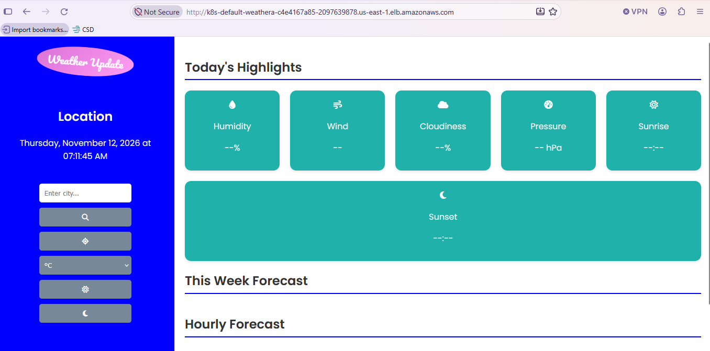

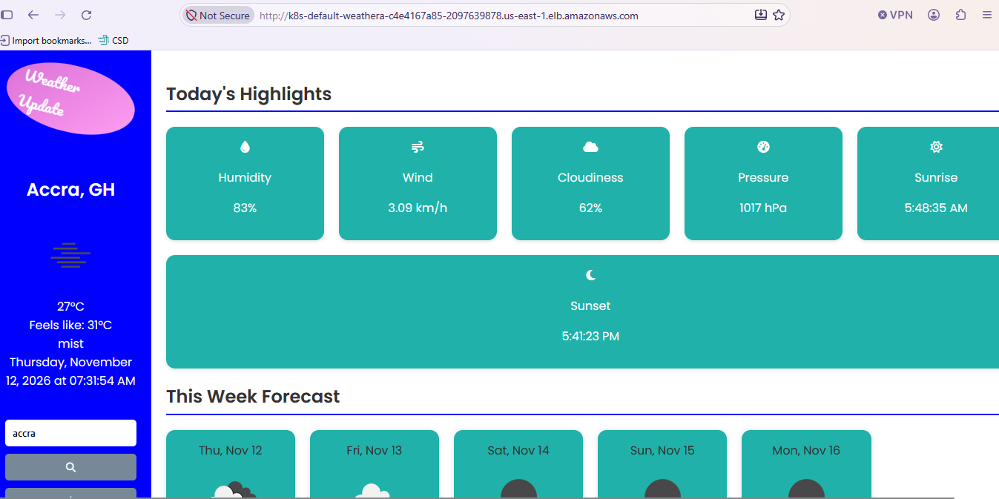

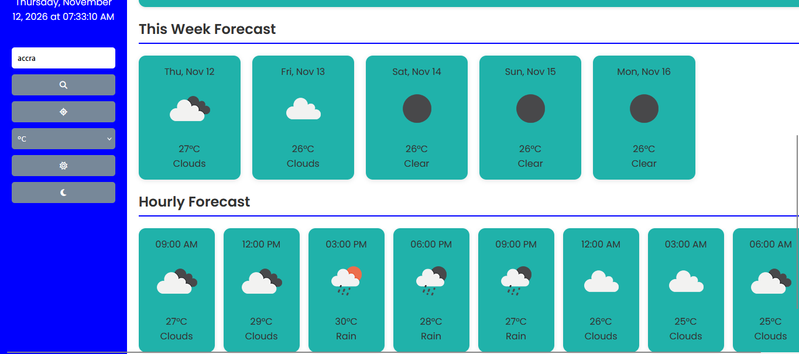

### AWS Infrastructure

**Amazon VPC**

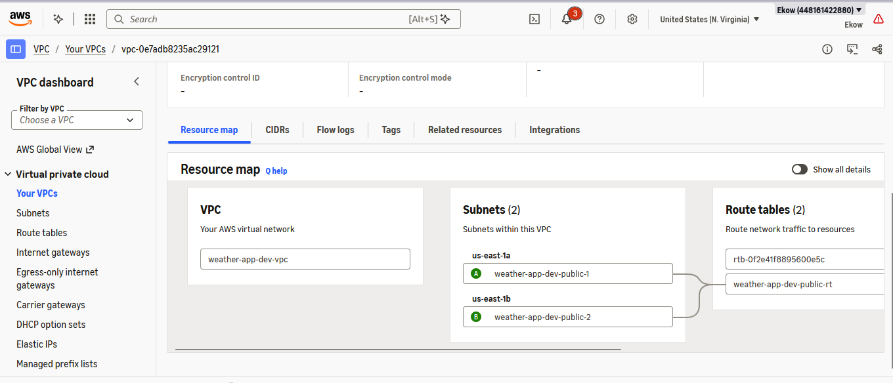

**Amazon ECR**

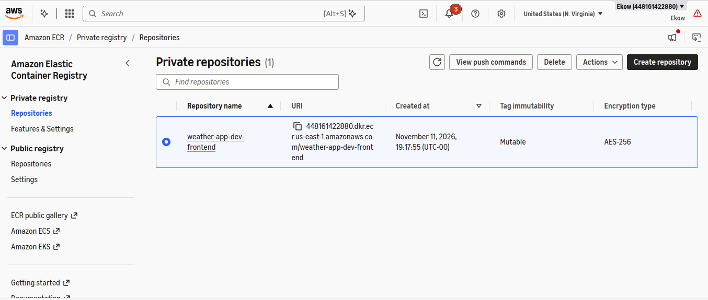

**Amazon EKS**

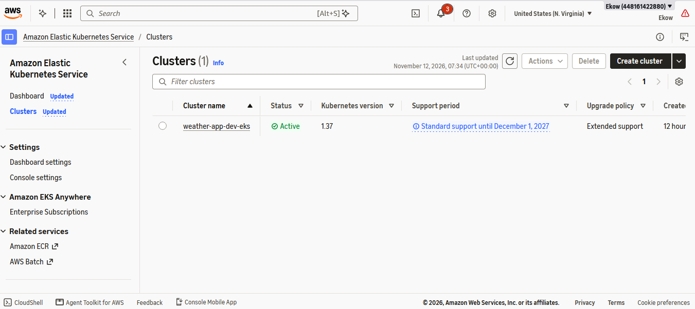

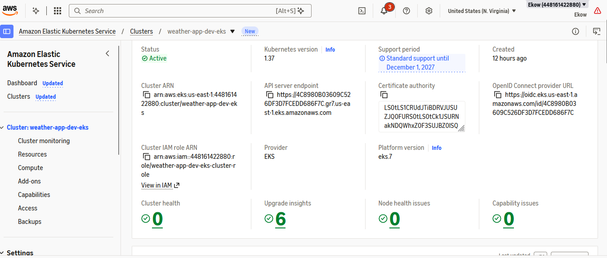

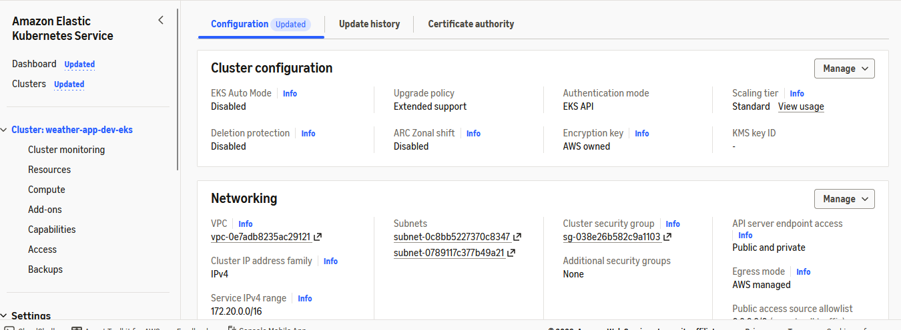

### CI/CD Pipeline

The following screenshots demonstrate the GitHub Actions deployment workflow.

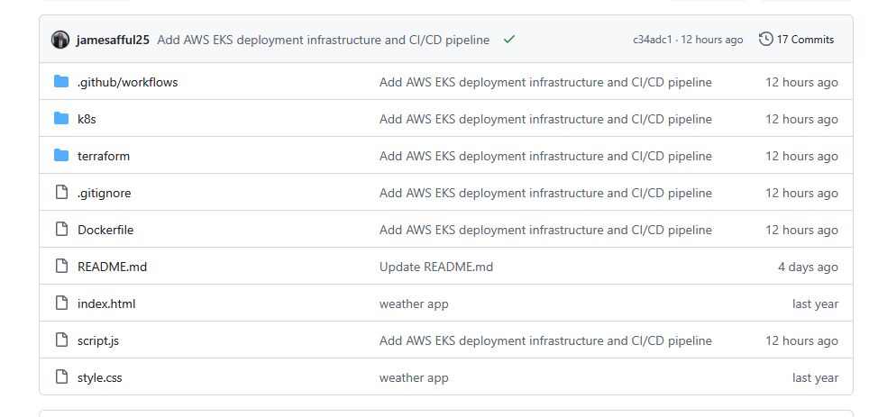

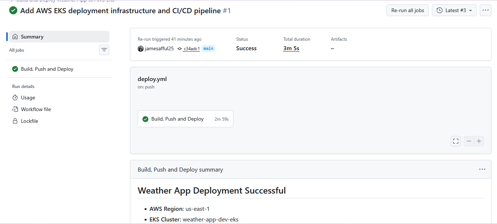

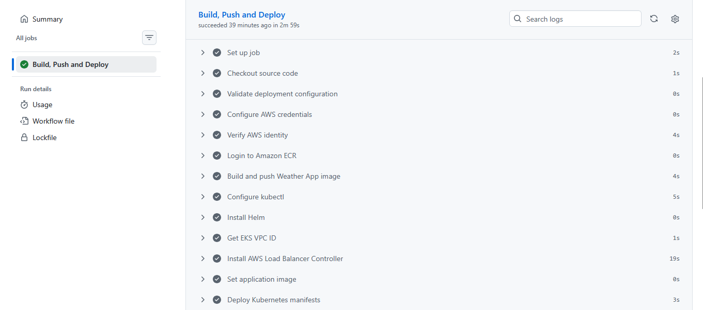

## 8. Project Structure

```text
Weather-App/
│
├── .github/
│   └── workflows/
│       └── deploy.yml
│
├── docs/
│   └── screenshots/
│       ├── application/
│       │   ├── homepage1.png
│       │   ├── homepage2.png
│       │   └── homepage3.png
│       │
│       ├── aws/
│       │   ├── ecr.png
│       │   ├── eks1.png
│       │   ├── eks2.png
│       │   ├── eks3.png
│       │   └── vpc.png
│       │
│       └── cicd/
│           ├── cicd1.png
│           ├── cicd2.png
│           └── cicd3.png
│
├── k8s/
│   ├── deployment.yaml
│   ├── service.yaml
│   └── ingress.yaml
│
├── terraform/
│
├── Dockerfile
├── index.html
├── script.js
├── style.css
└── README.md
```

## 9. Running the Application Locally

### Prerequisites

- Git.
- A modern web browser.
- Visual Studio Code or another code editor.
- An internet connection.
- An OpenWeatherMap API key.

### Step 1: Clone the Repository

```bash
git clone https://github.com/jamesafful25/Weather-App.git
```

### Step 2: Navigate into the Project

```bash
cd Weather-App
```

### Step 3: Weather API Configuration

The application uses the [OpenWeatherMap API](https://openweathermap.org/) to retrieve current weather conditions and forecast data.

```javascript

```

**Security note:** A key embedded in frontend JavaScript is visible to browser users. Do not commit a real API key to a public repository. Consider moving API requests behind a backend service for stronger key protection.

### Step 4: Launch the Application

Open `index.html` in a browser or use the Visual Studio Code Live Server extension.

## 10. Skills Demonstrated

**Frontend Development**
- HTML5, CSS3 and JavaScript.
- REST API integration.
- Asynchronous JavaScript and Fetch API.
- DOM manipulation.
- Responsive interface development.

**DevOps and Cloud Engineering**
- AWS cloud infrastructure.
- Terraform and Infrastructure as Code.
- Docker containerisation.
- Kubernetes orchestration.
- Amazon EKS and Amazon ECR.
- GitHub Actions CI/CD.
- AWS IAM and OIDC authentication.
- Helm and Kubernetes deployment automation.

**Deployment and Automation**
- Automated container image builds.
- Container image publishing.
- Infrastructure and application deployment.
- Deployment health verification.
- Documentation and source control management.

## 11. Author

**James Afful**

DevOps & Cloud Engineer | Backend Developer | AI Automation Engineer | Data Scientist & Economist

**Professional Links**

- GitHub: [github.com/jamesafful25](https://github.com/jamesafful25)
- Portfolio: [jamesafful25.github.io/james-afful-portfolio](https://jamesafful25.github.io/james-afful-portfolio/)
- Email: [james.afful47@gmail.com](mailto:james.afful47@gmail.com)

---

*Designed, developed and deployed by James Afful.*